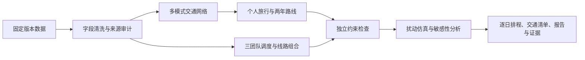
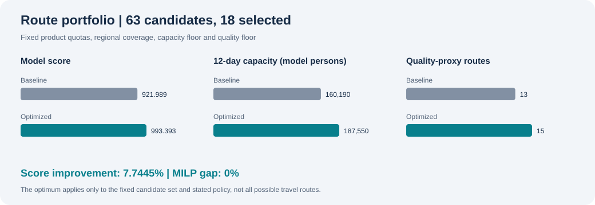
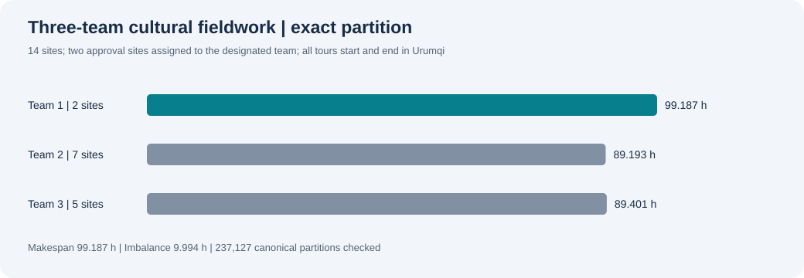

# 新疆旅游线路多场景优化

[](https://github.com/x29981412-maker/xinjiang-tourism-optimization/actions/workflows/verify.yml)

新疆旅游线路的课程建模项目，涉及个人出游、分年旅行、文化考察和节假日接待四类场景。研究中需要反复处理的取舍是：多去几个地方会不会赶不上开放时间，两年的行程怎样分配，接待容量增加后是否仍满足线路配额和质量要求。

**[研究报告](paper/main.pdf)** · **[可复算结果](results/generated/reproduction_report.md)** · **[模型设计](docs/model_design.md)** · **[个人贡献](docs/contributions.md)**

## 我参与的工作

在团队项目中负责数据整理与分析，参与目标与约束设计、Python 求解、情景仿真和结果验证。团队成果用于课程示范展示。2026 年 11 月使用 AI 辅助编程完善求解工具，增加独立约束核验、权重敏感性与需求压力测试，运行结果和输入版本一并保存在仓库。

团队研究开展于2026年4月至5月；当前求解工具与展示文档于2026年11月补强。具体分工及本轮实现范围见[贡献说明](docs/contributions.md)。

## 四类场景均可运行



| 决策问题 | 本仓库实现 | 固定数据下的运行结果 |
| --- | --- | --- |
| 30天个人旅行 | 多模式最短路 + 可行插入与有向2-opt + 开放时间排程 | 新情景模型：38个普通游客候选点，24天基础排程 |
| 两年分期旅行 | 多起点插入、分期枚举、跨年迁移与年度约束 | 完整覆盖38点；费用优先4/21天，均衡方案14/12天 |
| 63条候选线路中选择18条 | 0-1 MILP，保持产品配额、区域覆盖、容量与质量下界 | 综合分921.989204 → 993.392727，约提升7.745%；模型容量160190 → 187550人 |
| 14个文化点分配给3组 | Held–Karp子集路径动态规划 + 固定政策下的精确分组枚举 | 最晚完成99.187小时，组间差距9.994小时；对称去重后检查237127种分配 |

个人旅行和两年路线是本轮新实现的情景模型，使用公开参考数值数据，不等同于原报告的完整Q1/Q2模型。两项采用启发式搜索；后两项复算固定问题的精确解。各自边界见[模型说明](docs/model_design.md)。





详细数值、输入哈希、软件版本和核验记录保存在[reproduction.json](results/generated/reproduction.json)；旅行排程、清洗审计、仿真和搜索结果见[travel_study.json](results/generated/travel_study.json)。精确最优性限定于后两项的固定候选集合或特殊准入政策。

## 运行

Python 3.11及以上，在仓库根目录执行：

```bash
python -m pip install -r requirements.txt
python -m xinjiang_decision --verify
python -m unittest discover -s tests -v
```

无需地图密钥或外部服务。求解使用随SciPy提供的HiGHS。运行后生成：

- 18条入选线路及其分数、容量和质量指标；
- 三团队访问顺序、交通时间和现场作业时间；
- 38点清洗表、逐腿交通方式及原始边ID、个人和两年路线的逐日活动表；
- 费用优先与年度均衡的两年方案比较；
- 3条路线×3种扰动×500次仿真，共4500次，附固定种子与Wilson区间；
- 24/26/28/30天预算下的同样本缓冲分析；
- 5组偏好权重敏感性分析；
- 6组需求压力测试；
- SVG结果图、中文分析报告和带输入哈希的JSON证据。

可用 `--output-dir` 指定输出目录，`--simulations 1000 --seed 42` 调整仿真规模和种子。CI在独立环境运行34项测试，再跑通四场景和8项结果核验，其中5项对照参考结果、3项汇总新路线约束审计。

## 几个需要解释的结果

**权重变化会改变选择。** 容量优先情景选择的组合容量为189980人；舒适度优先时为180540人、质量代理通过数16条。各情景的评分权重不同，应比较方案构成和结果取舍，而非直接比较跨权重的综合分。

**需求上升会触及政策边界。** 在固定候选、配额和质量约束下，需求增至基准的2倍时无可行组合。此时需要讨论扩充候选、增加运力或调整政策，不能把不可行结果包装成成功方案。

**总量可接待不代表分时均可执行。** 模型容量不是实时库存，仍需结合景区分时利用率、住宿与车辆等局部瓶颈解释落地条件。

**均衡会改变方案成本。** 新增两年模型的费用优先方案境内双人交通代理费用为3498.97元，年度排程4/21天；限制年度天数差不超过7天后为3787.67元、14/12天。均衡方案多花288.70元。费用不含景区门票、住宿、餐饮和进出疆交通；票价与交通时间仍含研究情景参数。

**缓冲价值可以通过同一批样本比较。** 对同一个人路线的500次基准扰动，可用24天时完成比例59.0%，26天时98.2%。这些是明确假设下的情景结果，不能解释为实测成功率。

[查看完整敏感性与压力测试](results/generated/reproduction_report.md)

## 四类研究场景与当前复算范围

| 场景 | 团队研究问题 | 当前仓库状态 |
| --- | --- | --- |
| 30天个人旅行 | 覆盖、费用、缓冲日与扰动风险 | 新增可运行情景模型、逐日排程与扰动仿真；未复现原完整模型 |
| 两年分期旅行 | 费用、年度负担与交通衔接 | 新增全覆盖分期搜索、均衡约束与费用比较；未证明全局最优 |
| 三组文化考察 | 特殊准入、组内路径与最晚完成时间 | 已提供可运行的子集路径和精确分组 |
| 节假日接待 | 产品配额、区域、容量与质量约束 | 已提供可运行的MILP与敏感性、压力测试 |

输入是课程研究中的情景数据，部分参数经过模拟或校准。[数据来源与字段解释](data/SOURCES.md)保留了参考材料、版本和本地哈希。源代码在本仓库重新组织实现；参考工程的程序未整包迁入。

## 代码结构

```text
xinjiang_decision/
  data_pipeline.py   主外键、数值、开放时间与准入清洗审计
  network.py         多模式有向图、Dijkstra、同路径费用和时间
  itinerary.py       日历排程、个人路线与两年分期搜索、独立审计
  simulation.py      相关延误、固定种子、Wilson区间
  travel_study.py    旅行全流程与证据导出
  portfolio.py       MILP、独立约束审计、敏感性与压力测试
  scheduling.py      子集路径DP、精确分组、路线还原
  reporting.py       SVG图表与报告表格
  __main__.py        一键复算、参考核验与证据导出
data/reference/      固定版本的数值样例与参考结果
tests/              穷举对照、异常输入及约束测试
results/generated/  当前运行结果、图表和研究报告
docs/               数学模型、分工与实验解释
paper/              原团队研究报告及排版源码
```

交通网络含108个节点、1900条有向边。模型允许交通方式切换与抽象中途住宿，尚未逐班次匹配、跟踪租车归还或验证酒店库存；跨日游览允许续游，不单独计重入费用。日期相关闭馆也未逐日处理。候选点的边防证和预约视为已提前落实。这些假设均写入结果证据，后续接入真实数据时应继续约束。
